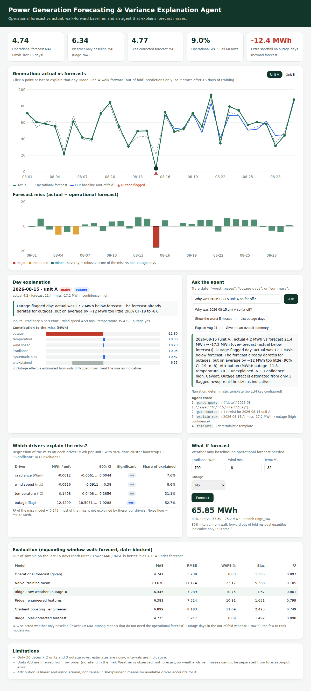

# Power Generation Forecasting & Variance Explanation Agent

Forecast renewable generation and explain variance against actual generation.
Python (FastAPI, pandas, scikit-learn) backend + dependency-free HTML/JS frontend, runs entirely on the bundled CSV.



## Quick start

```bash
python -m venv .venv && source .venv/bin/activate
pip install -r requirements.txt
uvicorn backend.app:app --reload          # UI at http://localhost:8000, API docs at /docs
pip install pytest httpx && python -m pytest -q   # 11 tests
```

Optional LLM narration: `export ANTHROPIC_API_KEY=...` (and optionally `LLM_MODEL`). Without a key the agent uses a deterministic template, and every number in the app is computed by code either way. No secrets are in the repo.

## What it does

| Piece | Where | Summary |
|---|---|---|
| Data loading/validation | `backend/pipeline.py::load_data` | Schema, NaN, negative and 0/1-flag checks; infers unit A/B (see assumptions). |
| Forecasting baseline | `pipeline.py` | Weather+outage regressions trained to predict `actual_mwh`: ridge (raw features), ridge (engineered), gradient boosting, plus a naive mean and a bias-corrected version of the operational forecast. |
| Validation | `pipeline.py::walk_forward` | Expanding-window, **date-blocked** CV (train on days 1..k, test on the next 3; both units of a date stay together). |
| Variance analysis | `pipeline.py::DriverModel`, `severity` | Regress the miss (`actual − forecast`) on irradiance, wind, temperature, outage. Coefficient = how much the operational forecast mis-weights that driver; per-row contribution = coef × (driver − mean); the remainder is "unexplained". 90% CIs from a date-cluster bootstrap. Severity = robust z-score of the miss. |
| Explanation agent | `backend/agent.py` | Routes a question (a date, "worst misses", "outage days", "summary") to tools (`get_records`, `rank_misses`, `explain_row`, `similar_conditions`, `fleet_summary`), logs a trace, writes the answer. Optional LLM rewrite is rejected if it contains numbers not in the evidence. |
| API | `backend/app.py` | `GET /api/health, /api/summary, /api/series, /api/variance`, `POST /api/forecast, /api/run`. |
| Frontend | `frontend/index.html` | KPIs, actual vs forecast chart, miss chart, per-day attribution, agent chat with trace, driver table, what-if forecast, evaluation table. |

## Evaluation results (walk-forward, 30 out-of-sample rows = last 15 dates × 2 units)

| Model | MAE (MWh) | RMSE | WAPE % | Bias | R² |
|---|---:|---:|---:|---:|---:|
| Operational forecast (given) | **4.74** | 5.24 | 8.03 | +1.37 | 0.897 |
| Ridge, bias-corrected operational forecast | 4.77 | 5.22 | 8.09 | +1.49 | 0.898 |
| Ridge, raw weather + outage (**selected weather-only baseline**) | 6.34 | 7.29 | 10.75 | +1.67 | 0.801 |
| Ridge, engineered features | 6.38 | 7.32 | 10.81 | +1.65 | 0.799 |
| Gradient boosting, engineered | 6.90 | 8.18 | 11.69 | +2.43 | 0.749 |
| Naive training mean | 13.68 | 17.17 | 23.17 | +5.36 | −0.105 |

**Honest reading:** our weather-only baseline cuts error by more than half versus a naive forecast but **does not beat the supplied operational forecast**, and neither does the bias-corrected version (a tie). The operational forecast tracks the weather closely (R² 0.96 against the four inputs), and what remains in the actual data looks like noise of roughly ±5 MWh. The baseline's value here is as an independent sanity check and a way to forecast without the operational forecast; it is not a replacement. The engineered features did not help versus raw ones at this sample size, so the simpler model was selected.

**Variance drivers (fleet level, all 60 rows)**

| Driver | MWh per unit | 90% CI | Reliable? |
|---|---:|---|---|
| Outage flag | −12.4 | −18.5 … −7.9 | **yes** |
| Temperature (°C) | +0.15 | −0.04 … +0.39 | no |
| Wind speed (m/s) | −0.09 | −0.59 … +0.38 | no |
| Irradiance (W/m²) | −0.001 | −0.006 … +0.004 | no |

The only reliable finding: the operational forecast already cuts output on outage days, but by about 12 MWh too little (it responds by ~19 MWh versus ~32 MWh actual). Temperature shows a weak hint that the forecast over-penalises heat (actual runs above forecast on hot days) but the interval includes zero. The four drivers together explain only ~25% of the miss variance (R² 0.246); the rest is reported as "unexplained", never forced onto a driver.

## Assumptions

1. The file has two rows per date and no site column. I assume they are two generating units/sites and label them A/B by order within the date. If your data has an `asset`/`asset_id` column it is used instead. Results do not depend on this beyond grouping the CV and labels.
2. `forecast_mwh` is the day-ahead operational forecast and `actual_mwh` is metered output over the same period.
3. Weather columns are **observed** values for the day (not forecast weather), and `outage_flag` is treated as known at forecast time (e.g. planned maintenance). A forced outage could not be known ahead; the what-if forecast then needs the flag set manually.
4. Units: MWh per day, W/m², m/s, °C. Miss = actual − forecast, so positive = under-forecast.
5. Rows are exchangeable apart from time; no autocorrelation modelling.

## Limitations and failure cases

- **Tiny data:** 30 dates × 2 units, 3 outage rows. All coefficients and intervals are noisy; the outage effect size in particular rests on three events. The 80% prediction interval comes from 30 out-of-fold residuals.
- **No model beat the operational forecast**, so I do not claim forecast improvement.
- Weather attribution is linear and associational; it cannot separate "the forecast mis-weighted a driver" from "the forecast's weather inputs were wrong" because forecast weather is not in the data.
- Outage days in the out-of-fold window: one row, so model ranking on outages is not meaningful.
- Single-month sample (August); no seasonality, so the model will not transfer to other months without retraining.
- Agent query parsing is rule-based (ISO dates, "Aug 15", unit letter, a few intents). Unrecognised questions fall back to the fleet summary.
- The LLM narration path is implemented and unit-tested only for the grounding guard; it has not been exercised against the live API here. The numeric guard is a heuristic, not proof of faithfulness.

## Production-readiness gaps / next steps

Real forecast-weather inputs and a per-site/asset model; hourly or 15-minute resolution; capacity and curtailment data; outage reason codes (planned vs forced); quantile or conformal prediction intervals; drift and bias monitoring with alerting; persisted model + data pipeline instead of fit-at-startup; auth and rate limiting on the API; structured logging; LLM evals for narration quality.

## Deploying to Railway

`Procfile` and `railway.json` are included (start command, `/api/health` healthcheck). Python 3.12 is pinned via `.python-version`.

1. Push this folder to a GitHub repo.
2. Railway → **New Project → Deploy from GitHub repo** → select it (Nixpacks detects Python from `requirements.txt`).
3. Service → **Settings → Networking → Generate Domain**.
4. (Optional) **Variables**: `ANTHROPIC_API_KEY`, `LLM_MODEL`.
5. Check `https://<your-domain>/api/health`, then open `/`.

CLI alternative: `npm i -g @railway/cli && railway login && railway init && railway up && railway domain`.
